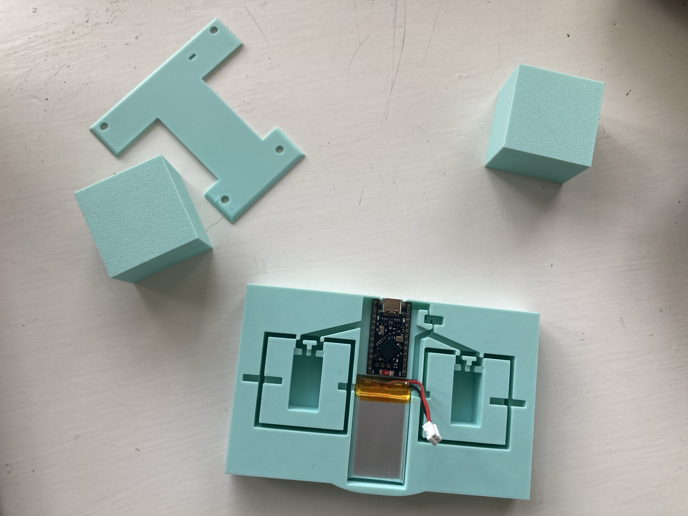
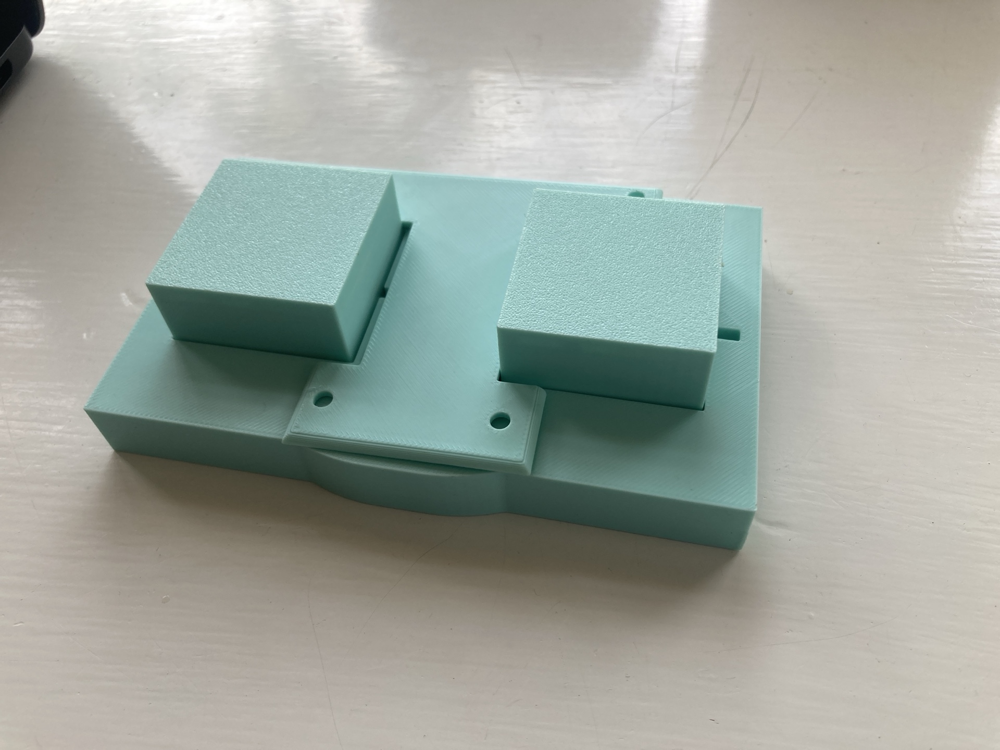

# Folia/Turner Pedal

A simple page turner and midi pedal for Forscore and Ableton.

I want a simple page turner pedal, but they're genuinely stupidly expensive ([an example](https://www.amazon.com.au/PageFlip-Butterfly-Bluetooth-Turner-Pedal/dp/B01LIROF7W?th=1)) for what they are, which is basically a two button bluetooth keyboard, with a simple plastic enclosure. So, I'm making one.

Another feature of this is that it can also do the MIDI protocol, either through Bluetooth or USB-C. This lets me control either ableton or forscore.

## Parts used
- Knockoff nice!nano v1 board with nrf52840 chip: about AU$5 [on aliexpress](https://www.aliexpress.com/item/1005006035267231.html)
- 2x heavy duty momentary guitar effects switch: I got both for about AU$6 [on aliexpress](https://www.aliexpress.com/item/32873378875.html)
- On/off switch - negligable price, I used [this one](https://www.aliexpress.com/item/1005005633418066.html)
- 500mAh battery - i had it left over from another project, but probably about $5. [This is the one i bought](https://www.aliexpress.com/item/1005006924508264.html)
- 3d printed enclosure

Total: about AU$15, although i have most of these parts already.

## Case design
The case is relatively simple. It is made out of four parts: a base, which houses the electronics, two button tops, which connect to the top of the heavy duty switches and are pressed by the feet, and a shield, which covers the electronics in the case and hides them from view. 


This first print was done in light blue out of convenience, and will likely be either reprinted or painted in black.

Case design files can be found in `/case` in this repo. There's both the main design, which is parametrically modelled with Fusion 360, and the exported STL files which can be 3d printed.
Note that these are v1 files, and might change

## Software Stack
Arduino, with Adafruit libraries. Find it in ```/firmware/```

## Licence
MIT. If you want to use it, that's awesome! If you have any questions, email me or DM [@louis](https://hackclub.enterprise.slack.com/team/U09DCJM36E8) on Hack Club slack